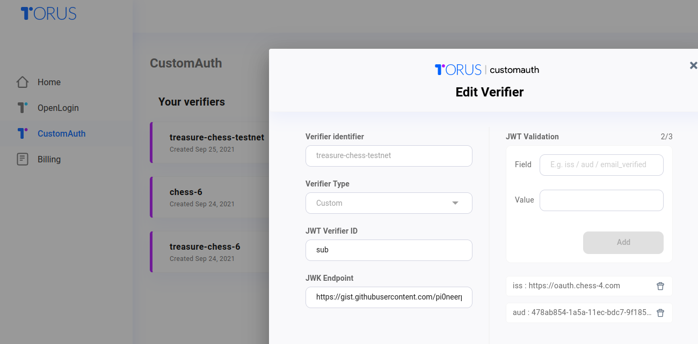

# Torus

## 📑 Resources

- Developer Dashboard [link](https://developer.tor.us/home/customauth)
- Custom Auth Docs [link](https://docs.tor.us/customauth/setting-up-verifiers/custom-verifier)

## 🌚 Development

Values shown here are for chess-4.com

| Verifier Property   | Value                                       | Notes                                                                           |
| :------------------ | :------------------------------------------ | :------------------------------------------------------------------------------ |
| Verifier Identifier | `treasure-chess-sandbox`                    |                                                                                 |
| Verifier Type       | `custom`                                    |                                                                                 |
| JWT Verifier ID     | `user_id`                                   | User's identity. Same as the `player_id` in the chess.com public API            |
| JWK Endpoint        | `https://oauth.chess.com/certs`             | See below                                                                       |
| JWT Validation (1)  | iss: `https://oauth.chess.com`              |                                                                                 |
| JWT Validation (2)  | aud: `40c5d866-77cd-11ec-a560-67b86d6160ee` | IMPORTANT! Ensures no other chess.com app can gain access to our user's wallets |

The `/certs` endpoint for chess-x.com is password-protected, so Torus nodes cannot access it. You'll need to copy the certs and host them yourself. Eg for chess-4.com you can use this gist link: https://gist.githubusercontent.com/pi0neerpat/baf278f9c16aea141356a61d8aaae93d/raw/1ee9f999f453c41efa0360af3487b85f1abfa8bf/certs.json

## 🌞 Production

| Verifier Property   | Value                           | Notes                                                                           |
| :------------------ | :------------------------------ | :------------------------------------------------------------------------------ |
| Verifier Identifier | `treasure-chess-prod-1`         |                                                                                 |
| Verifier Type       | `custom`                        |                                                                                 |
| JWT Verifier ID     | `user_id`                       | User's identity. Same as `player_id` in the chess.com public API                |
| JWK Endpoint        | `https://oauth.chess.com/certs` |                                                                                 |
| JWT Validation (1)  | iss: `https://oauth.chess.com`  |                                                                                 |
| JWT Validation (2)  | aud: `45...`                    | IMPORTANT! Ensures no other chess.com app can gain access to our user's wallets |

#### JWT Validation
