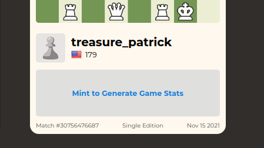

<h1 align="center"></h1>

<p align="center">
  <a href="#" target="_blank">
    
  </a>
  <a href="https://twitter.com/treasurechess_" target="_blank">
    
  </a>
</p>

**Almost all of the code & tooling for Treasure Chess has been open sourced**. We hope you find these resources useful. Happy hacking!

- App tooling using RedwoodJs 👉 https://github.com/pi0neerpat/redwood-devops-example
- Code specific to Treasure Chess (smart contracts, achievements, card generation, etc.) is on our organization page: https://github.com/treasure-chess

> HTML file generator for Treasure Chess

## Install

:warning: NOTE: this package is not yet published!

```sh
yarn add @treasure-chess/treasure-html
```

## Usage

Here's a React example that displays the card using `dangerouslySetInnerHTML`:

```js
// CommonJS, eg. for node

const getCard = require('@treasure-chess/treasure-html')
// ES6, eg. for React app
import getCard from '@treasure-chess/treasure-html'

const GameCard = ({ game }) => {
  const [cardHtml, setCardHtml] = React.useState()
  const update = async () => {
    const raw = await getCard({
      treasure: { ...game, title: 'My Game' },
      gifUrl:
        'https://images.chesscomfiles.com/uploads/game-gifs/90px/green/neo/0/cc/0/0/bEJaUmNEIVRtdTJVZ3Y5MmtBOCFiczVaZnRYUGVnNlhweFlJQkpXT2FiN1lzQ1RDdENQSGpyOTVka0h6eEZaVEN0T0dETUd5TVQwVEZOVEx2TVkwTXZYNmZlNFd1Q0xDdEMwVE5VM1VldTU0YmV5cmtyV3FyYnFpQ2tpYWJyYWV1ZTRhcnVhZXVlNlpvdyE5Z29UMGVjWkV2TUVaY0QwVE0zOSEzVDJURFQ,/cm5icWtibnIvcHBwcHBwcHAvOC84LzgvOC9QUFBQUFBQUC9STkJRS0JOUiB3IEtRa3EgLSAwIDE,.gif',
    })
    setCardHtml(raw)
  }
  React.useEffect(() => {
    if (!game) return
    update()
  }, game)
  return (
    <div
      className="min-w-258px"
      dangerouslySetInnerHTML={{ __html: cardHtml }}
    />
  )
}
```

If `treasure.achievements` is undefined, a prompt to mint the Treasure is shown instead, which looks like this:



## Development

Note that redwood won't automatically adopt new changes to the built package. You must trigger redwood to rebuild, eg. by saving any file in `web/src`.

```bash
yarn build

yarn build:watch
```

## Show your support

Give a ⭐️ if this project helped you!

## Contributors ✨

👤 **Treasure Chess Community <maintainers@niftychess.com>**

- Website: https://niftychess.com
  - Twitter: [@https:\/\/twitter.com\/niftychess](https://twitter.com/https://twitter.com/niftychess)
  - GitHub: [@Treasure-Chess](https://github.com/Treasure-Chess)

## 📝 License

Copyright © 2021 Nifty Chess, Inc.<br />
This project is [MIT](https://github.com/Treasure-Chess/chess-achievements/blob/master/LICENSE) licensed.

---

_This README was generated with ❤️ by [readme-md-generator](https://github.com/kefranabg/readme-md-generator)_
